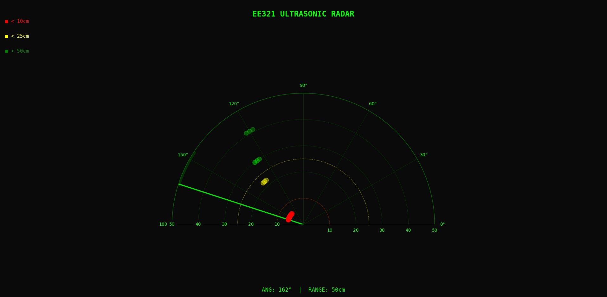
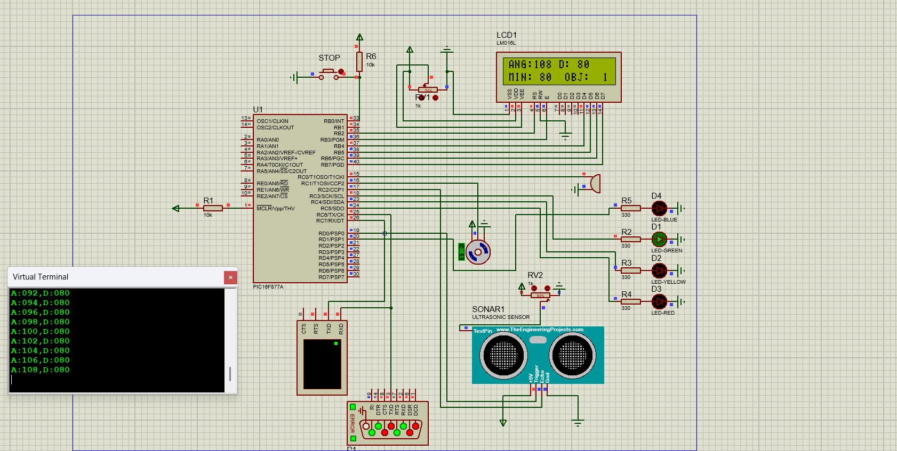

# PIC16F877A Ultrasonic Radar

A miniature ultrasonic radar (sonar) built around a **PIC16F877A** microcontroller. An HC-SR04 sensor mounted on an SG90 servo sweeps a 180° arc; each `(angle, distance)` pair is shown on a 16×2 LCD, triggers LED/buzzer proximity alerts, and is streamed over UART to a **Python real-time polar radar display**.

> EE321 Microprocessors final project, Özyeğin University (Spring 2025–26)

📺 **Demo video:** https://youtu.be/YELqr21fpyk
🎤 **Presentation video:** https://youtu.be/2gekZdm540c



---

## Features

- **180° scanning** in 5° steps with an SG90 servo driven by a **Timer1-based software PWM** library (no CCP module)
- **HC-SR04 distance measurement** using Timer1 echo timing (1:8 prescaler, 1 tick = 1.6 µs), with timeouts
- **HD44780 LCD driver** (4-bit mode) written from the datasheet, with no vendor libraries
- **Proximity alerts:** tri-colour LED + active buzzer driven by a zone state machine (GPIO is written only when the zone changes)
- **UART telemetry** at 9600 baud, 8N1, using the frame format `A:XXX,D:XXX\r\n`
- **Stop/Run button** with debounce and a blue "stopped" indicator
- **Python GUI:** threaded serial reader, animated polar plot, colour zones, fade-out of old detections, sweeping beam with trail, and a built-in test mode
- Fully verified in **Proteus VSM** before hardware assembly

## Hardware

| Component | Purpose |
|---|---|
| PIC16F877A @ 20 MHz (HS crystal) | Main controller |
| HC-SR04 | Ultrasonic distance sensor |
| SG90 | Servo for sweeping the sensor |
| HD44780 16×2 LCD | Local angle/distance readout |
| Green / Yellow / Red / Blue LEDs, active buzzer | Proximity alerts and status |
| Push button | Stop / Run toggle |
| CP2102 USB-UART | PC link |
| PICkit 3 | Programming |

### Pin map

| Port | Pin | Signal |
|---|---|---|
| PORTB | RB0 | STOP button (internal pull-up) |
| | RB2 / RB3 | LCD RS / EN |
| | RB4–RB7 | LCD D4–D7 |
| PORTC | RC0 | Buzzer (active low) |
| | RC1 | Servo PWM |
| | RC2 | HC-SR04 Echo |
| | RC3 / RC4 / RC5 | LED Green / Yellow / Red |
| | RC6 / RC7 | UART TX / RX |
| PORTD | RD0 | HC-SR04 Trigger |
| | RD1 | LED Blue (stopped) |

### Alert zones

| Distance | Zone | Output |
|---|---|---|
| < 10 cm | 🔴 Red | Red LED + buzzer |
| 10–25 cm | 🟡 Yellow | Yellow LED |
| ≥ 25 cm | 🟢 Green | Green LED |
| no echo (timeout or > 400 cm) | — | Treated as clear; `---` sent over UART |

The GUI displays objects up to 50 cm.

## How it works

Each main-loop iteration is one scan step:

1. `servo_write(angle)` sets the servo position, then waits 30 ms to settle
2. A 10 µs trigger pulse is sent on RD0
3. Timer1 measures the echo pulse width on RC2, giving `distance_cm = ticks / 36`
4. `update_alerts()` updates the LED/buzzer zone
5. `update_lcd()` overwrites the angle and distance fields in place (no clear, so no flicker)
6. `send_telemetry()` sends `A:XXX,D:XXX` over UART
7. The angle moves by ±5°, and direction reverses at 0° and 180°

Servo pulse mapping (SG90): `pulse_us = 540 + angle × 1910 / 180`, inside a 20 ms frame.

## Repository structure

```
firmware/EE321_final.X/   MPLAB X project (XC8): EE321.c, lcd.c/h, servo.c/h
gui/                      Python polar radar display
simulation/proteus/       Proteus VSM schematic
docs/                     Proposal, final report, presentation, images
```

## Getting started

### Firmware

1. Open `firmware/EE321_final.X` in **MPLAB X IDE** (tested with 5.50) using the **XC8** compiler
2. Build and flash it to the PIC16F877A with a PICkit 3

### Python GUI

```bash
cd gui
pip install -r requirements.txt

python radar_gui.py test    # test mode with synthetic data, no hardware needed
python radar_gui.py COM5    # real hardware or Proteus (Windows)
python radar_gui.py /dev/ttyUSB0   # Linux
```

### Proteus simulation



1. Install an **HC-SR04 ultrasonic sensor library** for Proteus (the project uses the UltraSonicSensor VSM model from TheEngineeringProjects) and add it to the Proteus library folder
2. Open `simulation/proteus/project_final.pdsprj` and load the compiled `.hex` file into the PIC (20 MHz, config word `0x3FFB`)
3. Create a virtual COM port pair with **com0com**. Assign one end to the `COMPIM` component (9600 8N1) and connect the GUI to the other end: `python radar_gui.py COMx`

## Authors

- **Bahittin Can Acar**
- **Süleyman Yiğit Dölek**

Instructor: H. Fatih Uğurdağ, Özyeğin University
